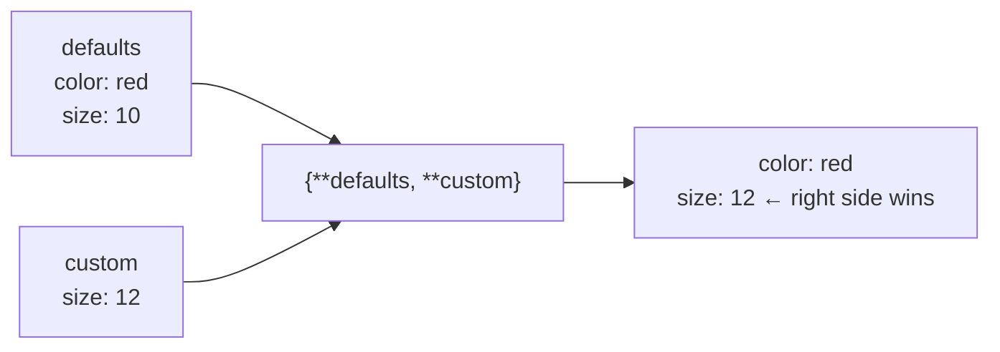

# Unpacking and Star Expressions

Unpacking assigns the items of an iterable to several names in one statement: `x, y = point`. Star expressions (`*rest`, `*args`, `**kwargs`) extend the idea to "the remaining items" and to spreading collections into function calls and literals. They appear everywhere in idiomatic Python: swaps, loops over pairs, function calls, merging dicts. They're also a frequent source of `ValueError: too many values to unpack`.

## 1. Basic (iterable) unpacking

The right side can be **any iterable**: tuple, list, string, range, generator or dict (which gives its keys).

```python
x, y = (3, 4)
a, b, c = "xyz"            # a='x', b='y', c='z'
first, second = [10, 20]
k1, k2 = {"p": 1, "q": 2}  # dict → keys: 'p', 'q'
```

The counts must match **exactly**:

```python
a, b = [1, 2, 3]   # ValueError: too many values to unpack (expected 2, got 3)
a, b, c = [1, 2]   # ValueError: not enough values to unpack (expected 3, got 2)
```

Use `_` by convention for values you don't care about:

```python
_, x, _ = (1, 2, 3)        # x = 2
name, _, age = "Ada,1815,36".split(",")
```

## 2. How assignment really works: evaluate the right side first

> [!KEY]
> In `targets = values`, the **entire** right-hand side is evaluated into objects first. Only then are the targets assigned, **left to right**.

That's why swaps need no temporary variable:

```python
a, b = b, a
nums = [1, 2, 3]
nums[0], nums[2] = nums[2], nums[0]   # swap two list elements → [3, 2, 1]
```

The left-to-right assignment order occasionally matters:

```python
i = 0
l = [5, 6]
i, l[i] = 1, 9      # i is assigned 1 FIRST, then l[i] means l[1]
print(i, l)          # 1 [5, 9]
```

This trips people up in linked-list reversal one-liners such as `prev, cur.next, cur = cur, prev, cur.next`. It works only because of that exact order. Prefer clear multi-line code when the targets depend on each other.

## 3. Starred assignment: `*rest`

One target may be prefixed with `*`. It collects **all the leftover items into a list** (possibly empty):

```python
first, *rest = [1, 2, 3, 4]        # first=1, rest=[2, 3, 4]
*init, last = [1, 2, 3, 4]         # init=[1, 2, 3], last=4
head, *middle, tail = "python"     # head='p', middle=['y','t','h','o'], tail='n'
only, *nothing = [42]              # only=42, nothing=[]
```

Rules:

- **At most one** starred target per level (`*a, *b = xs` is a `SyntaxError`, since it would be ambiguous).
- The starred name **always gets a list**, even when unpacking a tuple or string.
- The non-starred targets must still be satisfiable: `a, *b, c = [1]` raises `ValueError`.

```python
cmd, *args = "move 10 20".split()  # cmd='move', args=['10', '20']
```

## 4. Nested unpacking

The target structure can mirror the data structure:

```python
(a, b), c = (1, 2), 3                 # a=1, b=2, c=3
points = [(1, 2), (3, 4)]
for i, (x, y) in enumerate(points):   # the most common real use
    print(i, x, y)

data = {"ada": (36, "London")}
for name, (age, city) in data.items():
    print(name, age, city)
```

## 5. Unpacking in function calls: `*` and `**`

In a **call**, `*iterable` spreads items as positional arguments and `**mapping` spreads key/value pairs as keyword arguments:

```python
def volume(l, w, h):
    return l * w * h

dims = [2, 3, 4]
print(volume(*dims))                          # volume(2, 3, 4) → 24
opts = {"l": 2, "w": 3, "h": 4}
print(volume(**opts))                         # volume(l=2, w=3, h=4) → 24
print(volume(2, *[3], **{"h": 4}))            # mixing → 24

print(*["a", "b", "c"], sep="-")              # a-b-c
matrix = [[1, 2], [3, 4], [5, 6]]
print(list(zip(*matrix)))                     # transpose: [(1, 3, 5), (2, 4, 6)]
```

The matching **definition** side, `def f(*args, **kwargs)`, collects arguments instead of spreading them. That's in the Parameters lesson.

## 6. Unpacking inside literals (PEP 448)

`*` and `**` also work inside list, tuple, set and dict displays:

```python
a, b = [1, 2], (3, 4)
print([*a, *b, 5])              # [1, 2, 3, 4, 5]
print((*a, 0))                  # (1, 2, 0)
print({*a, *b, 1})              # {1, 2, 3, 4}
defaults = {"color": "red", "size": 10}
custom = {"size": 12}
print({**defaults, **custom})   # {'color': 'red', 'size': 12}: later keys win
print([*range(3), *"ab"])       # [0, 1, 2, 'a', 'b']
```



## 7. Common patterns

```python
# swap / rotate
a, b, c = b, c, a

# split head and tail of input
n, *values = map(int, input().split())

# min and max in one return
lo, hi = min(xs), max(xs)

# iterate pairs from dict.items()
for key, value in counts.items(): ...

# ignore parts
year, month, _ = "2026-10-24".split("-")

# first element of a dict's items
(first_key, first_val), *_ = d.items()     # or next(iter(d.items()))
```

## 8. Exam-ready answers

> [!EXAM]
> **Sequence unpacking.** Unpacking assigns the elements of any iterable to a comma-separated list of targets, for example `x, y = point`. The right-hand side is evaluated completely before any target is assigned, and the targets are then assigned from left to right. This is why `a, b = b, a` swaps two values without a temporary variable. The number of targets must equal the number of elements unless one target is starred (`first, *rest = seq`), in which case the starred target receives a list of the remaining elements. Targets may be nested to match nested data, e.g. `for i, (x, y) in enumerate(points)`.

> [!EXAM]
> **`*` and `**` in calls and displays.** In a function call, `*iterable` unpacks the items as positional arguments and `**mapping` unpacks key–value pairs as keyword arguments. Inside list, tuple and set displays `*iterable` inserts the items, and inside dictionary displays `**mapping` merges the mapping, with later keys overriding earlier ones.

## 9. Cheat sheet

| Need | Code |
|---|---|
| swap | `a, b = b, a` |
| head / rest | `head, *rest = seq` |
| rest / last | `*init, last = seq` |
| ignore values | `_, x, _ = triple` |
| loop over pairs | `for k, v in d.items():` |
| index + pair | `for i, (x, y) in enumerate(ps):` |
| list → arguments | `f(*args_list)` |
| dict → keyword arguments | `f(**options)` |
| concatenate lists | `[*a, *b]` |
| merge dicts | `{**a, **b}` |
| transpose | `list(zip(*m))` |

> [!INTERVIEW]
> **"Reverse a linked list in one line inside a loop."** `prev, cur.next, cur = cur, prev, cur.next`. The right side is built first as `(cur, prev, cur.next)` using the *old* values. Then the targets are assigned left to right: `prev`, then `cur.next` (on the old `cur`, which is still bound), then `cur`. If you reorder the targets to `cur, cur.next, prev = ...`, `cur.next` refers to the *new* `cur` and the list breaks. Knowing this order is what the question tests.
