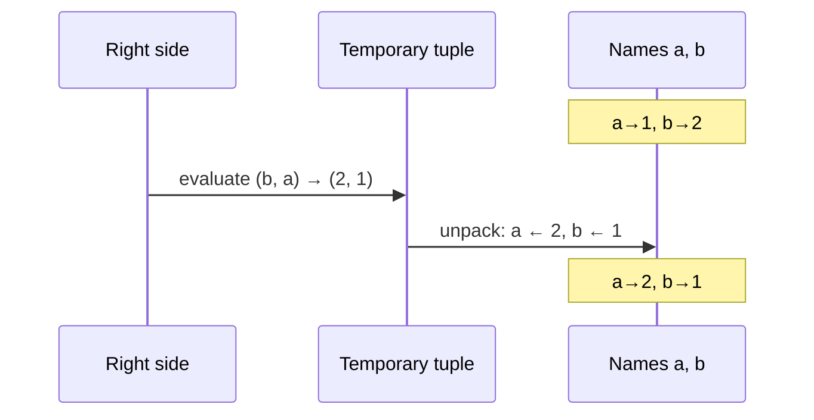

# Variables and the Object Model

This is the single most important mental model in Python, and the one most people coming from C get wrong. In C, a variable is **a box in memory that holds a value**. In Python, a variable is **a name tag tied to an object**. Almost every "surprising" Python behaviour comes from this difference: aliasing, mutable default arguments, `is` vs `==`, why `+=` sometimes changes another variable. Learn it properly now and those surprises go away.

## 1. Everything is an object

Every value in Python, including `5`, `"hi"`, `None`, a list, a function or a class, is an **object** living somewhere in memory (the heap). Every object has three things:

| Property | Meaning | How to see it | Can it change? |
|---|---|---|---|
| **Identity** | Which object it is (in CPython, its memory address) | `id(obj)` | Never, for the object's lifetime |
| **Type** | What kind of object it is and what operations it supports | `type(obj)` | Never (in practice) |
| **Value** | The data it holds | printing it, `==` | Only if the type is **mutable** |

```python
x = 42
print(type(x), id(x))
```

```output
<class 'int'> 140712354631240
```

(The `id` number differs on every run.)

## 2. Assignment binds a name to an object

> [!KEY]
> `name = expression` means: **evaluate the right side to an object, then bind the name on the left to that object.** Assignment never copies an object.

```python
a = [1, 2, 3]
b = a          # b is bound to the SAME list object, no copy is made
b.append(4)
print(a)
```

```output
[1, 2, 3, 4]
```

<div class="figure">
<svg viewBox="0 0 520 180" width="520" xmlns="http://www.w3.org/2000/svg" font-family="ui-monospace, monospace" font-size="14">
  <defs><marker id="ar" markerWidth="10" markerHeight="10" refX="9" refY="5" orient="auto"><path d="M0,0 L10,5 L0,10 z" fill="currentColor"/></marker></defs>
  <text x="20" y="20" font-family="sans-serif" font-size="12" fill="currentColor" fill-opacity=".6">NAMES (namespace)</text>
  <text x="270" y="20" font-family="sans-serif" font-size="12" fill="currentColor" fill-opacity=".6">OBJECTS (heap)</text>
  <rect x="20" y="40" width="70" height="34" rx="6" fill="none" stroke="#2f81f7" stroke-width="2"/>
  <text x="48" y="62" fill="currentColor">a</text>
  <rect x="20" y="110" width="70" height="34" rx="6" fill="none" stroke="#2f81f7" stroke-width="2"/>
  <text x="48" y="132" fill="currentColor">b</text>
  <rect x="270" y="70" width="220" height="50" rx="8" fill="none" stroke="#3fb950" stroke-width="2"/>
  <text x="285" y="92" fill="currentColor">list  id=0x7f…a0</text>
  <text x="285" y="111" fill="currentColor">[1, 2, 3, 4]</text>
  <line x1="92" y1="57" x2="266" y2="88" stroke="currentColor" marker-end="url(#ar)"/>
  <line x1="92" y1="127" x2="266" y2="104" stroke="currentColor" marker-end="url(#ar)"/>
</svg>
<figcaption>Two names, one object. Mutating through <code>b</code> is visible through <code>a</code>.</figcaption>
</div>

This is called **aliasing**: two names refer to one object. The "variable is a box" model predicts `a` is unchanged, and that prediction is wrong.

## 3. Rebinding vs mutating

There are two completely different things you can do with a name:

- **Rebind** it: `b = something_else`. The name now points elsewhere. The old object is untouched.
- **Mutate** the object it points to: `b.append(4)`, `b[0] = 9`. The object changes, and every name bound to it sees the change.

```python
a = [1, 2]
b = a
b = [9, 9]      # REBIND b: a is unaffected
print(a, b)     # [1, 2] [9, 9]

c = a
c[0] = 100      # MUTATE the shared object
print(a, c)     # [100, 2] [100, 2]
```

## 4. Mutable vs immutable types

| Immutable (value can never change) | Mutable (value can change in place) |
|---|---|
| `int`, `float`, `complex`, `bool` | `list` |
| `str` | `dict` |
| `tuple` (the slots can't be rebound) | `set` |
| `frozenset`, `bytes`, `None` | `bytearray`, most user-defined objects |

With immutable objects, "changing" a value always creates a **new object** and rebinds the name:

```python
x = 10
print(id(x))
x = x + 1          # builds a NEW int object 11, rebinds x
print(id(x))       # different id
```

```python
s = "cat"
# s[0] = "b"       # TypeError: 'str' object does not support item assignment
s = "b" + s[1:]    # build a new string instead
```

> [!KEY]
> Because immutable objects can never change, aliasing them is always safe. `x = 5; y = x; x += 1` leaves `y == 5`. The `+=` rebound `x` to a new object, and `y` still points to the old one.

### The `+=` subtlety

For immutable types `x += 1` means `x = x + 1` (a new object). For mutable types like lists, `+=` **mutates in place** (it calls `__iadd__`, which extends the list):

```python
a = [1]
b = a
a += [2]        # in-place: the shared list grows
print(b)        # [1, 2]

a = a + [3]     # builds a NEW list and rebinds a
print(b)        # [1, 2]  (b still on the old list)
```

## 5. `==` vs `is`

- `a == b` compares **values**: "do these two objects hold equal data?" (it calls `__eq__`)
- `a is b` compares **identity**: "are these the very same object?" (`id(a) == id(b)`)

```python
x = [1, 2, 3]
y = [1, 2, 3]
z = x
print(x == y, x is y)   # True False  (equal values, two objects)
print(x == z, x is z)   # True True   (same object)
```

> [!DANGER]
> Use `is` **only** to compare with singletons: `if x is None:`, `is True/False` (rarely needed). Never compare numbers or strings with `is`. It sometimes *appears* to work because of caching (next section), then fails on other values.

### Caching and interning (why `is` "works" by accident)

CPython pre-creates the integers **-5 to 256** and reuses them. It also **interns** many short strings that look like identifiers. So:

```python
a = 256; b = 256
print(a is b)          # True  (same cached object)

a = int("1000"); b = int("1000")
print(a is b)          # False (two different objects)
print(a == b)          # True
```

These are implementation details of CPython and can change. Correct code never depends on them.

## 6. Dynamic typing, strong typing

Python is **dynamically typed**: *names* have no types; *objects* do. A name can be rebound to an object of any type:

```python
v = 10        # v → int
v = "ten"     # v → str: perfectly legal
```

Python is also **strongly typed**: an object's type is never silently reinterpreted. `"3" + 4` is a `TypeError`, not `"34"` (JavaScript) or `7` (some loose languages).

| | Static (C, C++, Java) | Dynamic (Python, JS) |
|---|---|---|
| Types attached to | variables, checked at compile time | objects, checked at run time |
| | **Strong** (Python, Java) | **Weak** (C, JavaScript) |
| Implicit reinterpretation | rare, explicit conversion required | common (`"3" * 1`, pointer casts) |

## 7. Multiple targets, swapping and deleting

```python
x = y = 0          # chained: both names bound to the same object 0
a, b = 1, 2        # tuple unpacking
a, b = b, a        # swap without a temp: right side is built first
del a              # removes the NAME a (not necessarily the object)
```

`del name` unbinds a name. The object itself is destroyed only when **no** names or references to it remain. CPython tracks this with **reference counting**. Using a name after `del` raises `NameError`.

> [!WARNING]
> `x = y = []` makes **one** list with two names. Appending through `x` shows up in `y`. For two independent lists write `x, y = [], []`.

## 8. How the swap really works



The entire right-hand side is evaluated **before** any name on the left is rebound. That's why `a, b = b, a` doesn't lose a value.

## 9. Exam-ready answers

> [!EXAM]
> **Variables in Python.** A Python variable is a name bound to an object, not a storage location holding a value. Assignment (`name = expr`) evaluates the expression to an object and binds the name to it; it never copies the object. Every object has an identity (`id()`), a type (`type()`) and a value. Several names may refer to the same object (aliasing). Python is dynamically typed, because types belong to objects and a name may be rebound to objects of different types, and strongly typed, because operations between incompatible types raise `TypeError` rather than converting implicitly.

> [!EXAM]
> **Mutable vs immutable objects.** An immutable object's value cannot change after creation (`int`, `float`, `str`, `tuple`, `frozenset`); operations that seem to modify it create a new object. A mutable object (`list`, `dict`, `set`) can be modified in place, and the change is visible through every name that refers to it. Immutable objects are hashable when their contents are, so they can be dictionary keys.

> [!EXAM]
> **`is` vs `==`.** `==` tests value equality by invoking `__eq__`; `is` tests identity, i.e. whether both operands are the same object. `is` should be used only for singletons such as `None`.

## 10. Cheat sheet

| Expression | Meaning |
|---|---|
| `id(x)` | identity (address in CPython) |
| `type(x)` | the object's class |
| `isinstance(x, int)` | type check that respects inheritance (prefer over `type(x) == int`) |
| `a is b` | same object? |
| `a == b` | equal values? |
| `b = a` | alias, no copy |
| `b = a.copy()` / `list(a)` / `a[:]` | shallow copy of a list |
| `del x` | unbind the name `x` |

> [!INTERVIEW]
> **"What is printed?"** `a = [1, 2]; b = a; a = a + [3]; print(b)` → `[1, 2]`. But with `a += [3]` → `[1, 2, 3]`. The interviewer is testing whether you know `+` builds a new list while `+=` on a list mutates in place.
