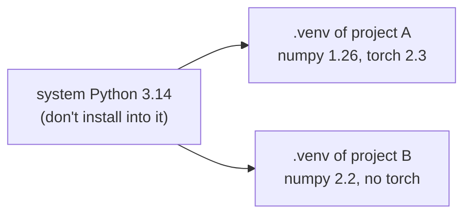

# Virtual Environments, pip, uv and pyproject

Your code depends on other people's code: NumPy, requests, PyTorch. Different projects need different versions of the same library, and installing everything into the system Python eventually breaks something. (On Ubuntu, the system pip refuses outright: "externally-managed-environment", PEP 668.) **Virtual environments** isolate each project's dependencies, **pip** and **uv** install packages into them, and **`pyproject.toml`** declares what your project needs and how to build it.

## 1. Virtual environments

A virtual environment (venv) is a directory containing its own `python` executable link and its own `site-packages`, so packages installed there are visible only when that environment is active.

```bash
python3 -m venv .venv            # create (standard library tool)
source .venv/bin/activate        # activate on Linux/macOS  (Windows: .venv\Scripts\activate)
python -m pip install requests   # installs into .venv only
deactivate                       # leave
```



> [!KEY]
> - One venv **per project**, usually `.venv` in the project root, listed in `.gitignore` (never commit it).
> - `python -m pip` (rather than plain `pip`) guarantees you use the pip that belongs to the active interpreter.
> - You don't strictly need to "activate": running `.venv/bin/python script.py` uses the venv directly.

## 2. pip essentials

| Command | Does |
|---|---|
| `pip install pkg` | install the latest version |
| `pip install "pkg>=2,<3"` | install with a version constraint |
| `pip install -r requirements.txt` | install a list |
| `pip install -e .` | **editable** install of your own project (code changes apply without reinstalling) |
| `pip list` / `pip show pkg` | inspect |
| `pip freeze > requirements.txt` | pin exact installed versions |
| `pip uninstall pkg` | remove |

**Version specifiers**: `==1.2.3` (exact), `>=1.2` (minimum), `~=1.2` (compatible: ≥1.2, <2.0), `<2`. Libraries should declare *ranges*; applications should *lock* exact versions for reproducibility.

## 3. uv: the modern, fast tool

`uv` (from Astral, the makers of ruff) replaces pip, venv and pip-tools with one very fast Rust binary. It's what this machine uses.

```bash
uv venv                        # create .venv
uv pip install numpy           # pip-compatible interface, 10–100× faster
uv init robot-project          # new project with pyproject.toml
uv add requests numpy          # add dependencies (updates pyproject.toml and uv.lock)
uv run python -m robot         # run inside the project's environment, syncing it first
uv sync                        # make .venv match the lock file exactly
```

`uv.lock` records the exact version of every dependency (including transitive ones), so every machine and CI run gets the same environment.

## 4. `pyproject.toml`: the project's single source of truth

```toml
[project]
name = "robot-control"
version = "0.1.0"
description = "Controllers and sensor drivers for a differential-drive robot"
requires-python = ">=3.12"
dependencies = [
    "numpy>=2.0",
    "pyserial>=3.5",
]

[project.optional-dependencies]
dev = ["pytest>=8", "mypy", "ruff"]

[project.scripts]
robot = "robot.__main__:main"     # installs a `robot` command that calls main()

[build-system]
requires = ["hatchling"]
build-backend = "hatchling.build"

[tool.ruff]                        # tools read their config from here too
line-length = 100

[tool.pytest.ini_options]
testpaths = ["tests"]
```

| Table | Purpose |
|---|---|
| `[project]` | name, version, Python requirement, dependencies (PEP 621) |
| `[project.optional-dependencies]` | extras: `pip install "robot-control[dev]"` |
| `[project.scripts]` | console commands created on install |
| `[build-system]` | which backend builds wheels (hatchling, setuptools, flit, uv_build) |
| `[tool.*]` | configuration for ruff, mypy, pytest, etc. |

## 5. Distributions: wheels and sdists

- **sdist** (source distribution, `.tar.gz`): source code plus metadata. Building it may require compilers.
- **wheel** (`.whl`): a pre-built zip that installs by simply unpacking. Platform-specific wheels contain compiled C extensions (that's how `pip install numpy` avoids needing a compiler).

`uv build` (or `python -m build`) produces both in `dist/`. `uv publish` / `twine upload` sends them to PyPI.

## 6. Reproducibility checklist

1. A `.venv` per project, git-ignored.
2. Dependencies declared in `pyproject.toml` with sensible ranges.
3. A lock file (`uv.lock`, or `requirements.txt` from `pip freeze` / `pip-compile`) committed.
4. `requires-python` set.
5. One command to set everything up (`uv sync`), documented in the README.

> [!DANGER]
> - Don't `sudo pip install`. It modifies the OS Python that system tools rely on.
> - Don't commit `.venv/`: it's large, machine-specific and rebuildable.
> - Supply-chain safety: check package names carefully (typosquatting like `reqeusts`), and prefer locked, hashed dependencies in production.

## 7. Exam-ready answers

> [!EXAM]
> **Virtual environments.** A virtual environment is an isolated Python environment with its own interpreter link and `site-packages` directory, created with `python -m venv` (or `uv venv`). Packages installed while it is active are confined to it, allowing different projects to use different, possibly conflicting, versions of the same libraries without affecting the system installation. Dependencies are installed with pip or uv, declared in `pyproject.toml`, and pinned in a lock or requirements file for reproducible installations.

> [!EXAM]
> **`pyproject.toml`.** `pyproject.toml` is the standard configuration file for Python projects. Its `[project]` table declares metadata such as the name, version, supported Python versions and runtime dependencies; `[build-system]` specifies the build backend used to create source distributions and wheels; and `[tool.*]` tables hold configuration for development tools such as pytest, mypy and ruff.

## 8. Cheat sheet

| Need | Command |
|---|---|
| create venv | `uv venv` / `python3 -m venv .venv` |
| activate | `source .venv/bin/activate` |
| install | `uv pip install pkg` / `python -m pip install pkg` |
| add a dependency to the project | `uv add pkg` |
| editable install of your code | `uv pip install -e .` |
| run in the project env | `uv run python main.py` |
| lock / reproduce | `uv lock`, `uv sync` |
| build | `uv build` |
| freeze (pip) | `pip freeze > requirements.txt` |

> [!INTERVIEW]
> **"What's the difference between dependencies in `pyproject.toml` and a lock file?"** `pyproject.toml` states *compatible ranges* (what your code supports, e.g. `numpy>=2.0`). The lock file records the *exact resolved versions* of every package, including transitive dependencies, used for a known-good install. Libraries publish ranges so they don't over-constrain users; applications and services deploy from the lock file so every environment is identical.
